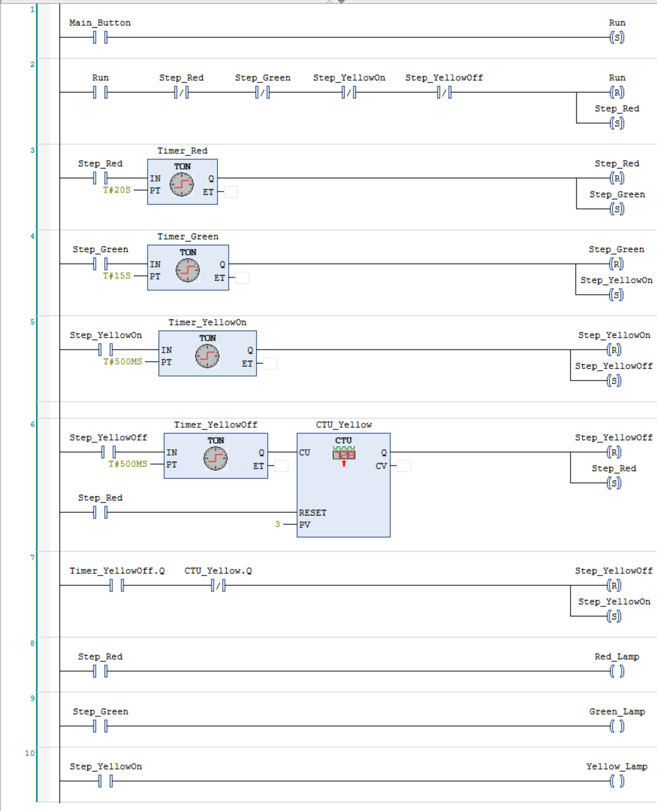
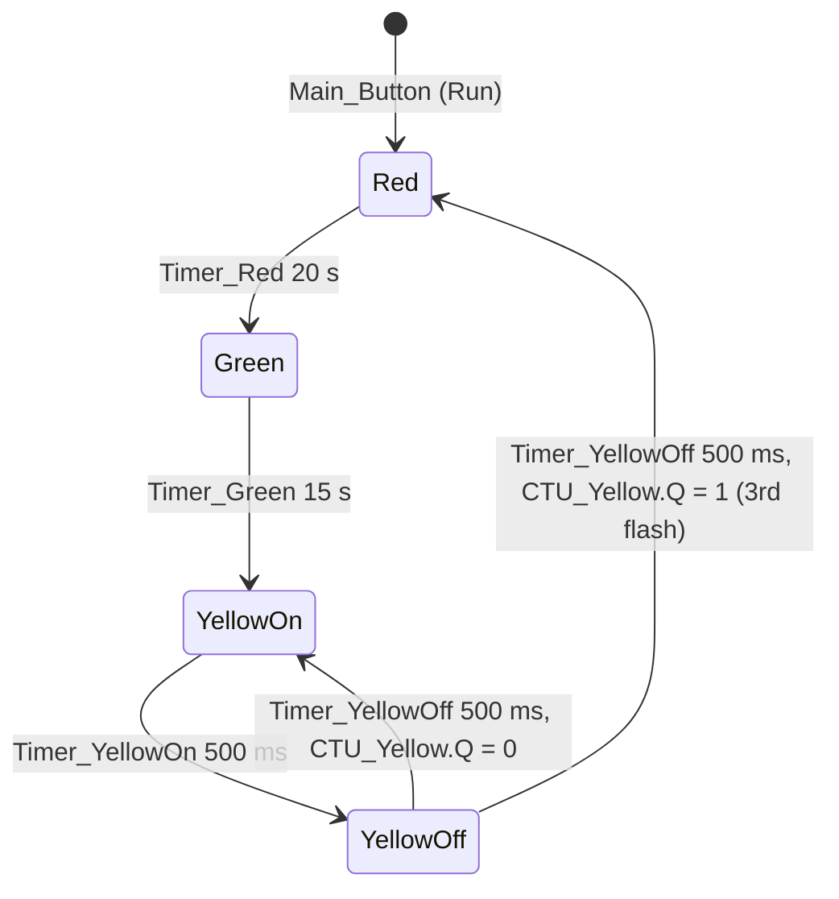

# PLC Traffic Light Controller (CODESYS, Ladder Diagram)

A traffic light sequence written in IEC 61131-3 Ladder Diagram in CODESYS. It's structured as an explicit state machine rather than a chain of timers: each phase owns a latched step bit, a TON timer decides when to leave the phase, and the lamp coils are driven from the step bits alone.

Runs in CODESYS simulation mode.

## Sequence

Red for 20 s, green for 15 s, then amber flashes three times (500 ms on, 500 ms off) and the cycle returns to red. One full cycle takes 38 s.

## How the rungs work

| Rung | Logic | Purpose |
|---|---|---|
| 1 | `Main_Button` → **S** `Run` | Start request |
| 2 | `Run` AND no step active → **R** `Run`, **S** `Step_Red` | Enter the first state only from idle |
| 3 | `Step_Red` → `Timer_Red` (TON, 20 s) → **R** `Step_Red`, **S** `Step_Green` | Red phase |
| 4 | `Step_Green` → `Timer_Green` (TON, 15 s) → **R** `Step_Green`, **S** `Step_YellowOn` | Green phase |
| 5 | `Step_YellowOn` → `Timer_YellowOn` (TON, 500 ms) → **R** `Step_YellowOn`, **S** `Step_YellowOff` | Amber on half-period |
| 6 | `Step_YellowOff` → `Timer_YellowOff` (TON, 500 ms) → `CTU_Yellow` (PV = 3, reset by `Step_Red`) → **R** `Step_YellowOff`, **S** `Step_Red` | Count flashes; leave after the third |
| 7 | `Timer_YellowOff.Q` AND NOT `CTU_Yellow.Q` → **R** `Step_YellowOff`, **S** `Step_YellowOn` | Flash again |
| 8–10 | `Step_Red` → `Red_Lamp`, `Step_Green` → `Green_Lamp`, `Step_YellowOn` → `Yellow_Lamp` | Outputs |

## Design decisions

- **Step bits with set/reset coils, not timer chains.** Each transition resets the current step and sets the next one in the same rung, so exactly one step is active at a time, and the active state is visible in one place.
- **Outputs depend only on state (Moore-style).** Lamps are plain coils driven by step bits, so a lamp can never disagree with the state the program thinks it's in.
- **The amber flash is counted, not timed.** A CTU counts completed off-periods, so changing the number of flashes means changing `PV` instead of adding timers and rungs. The counter is reset by `Step_Red`, so it starts from zero every cycle.

## Known limitations and next steps

- **No stop or fault input.** Once started, the cycle can't be halted. Next: a `Stop` input that resets every step bit and returns to idle, because a sequence you can't stop isn't a controller.
- **No safe state on startup or fault.** A real intersection controller falls back to flashing red. That's the obvious next state to add.
- **Simulation only.** It isn't mapped to physical I/O yet.
- **Port to Verilog.** The same state machine, as RTL with a self-checking testbench.

## Open it

1. Install CODESYS V3.5 (free from the CODESYS Store).
2. Open `Traffic_Lights_LD.project`.
3. **Online → Simulation**, then **Login** and **Start**. Set `Main_Button` to TRUE in the watch window to start the cycle.

---
Pedro Zambrano-Saucedo · Electrical Engineering, UTEP · [Portfolio](https://pazambranosauc.github.io/pazambranosauc/)
